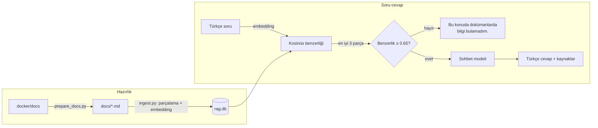

# Docker Asistanı: Foundry Local ile Yerel RAG

Docker'ın resmi dokümantasyonu üzerinde **tamamen yerel ve internetsiz** çalışan bir soru-cevap asistanı. Türkçe soruları, ilgili İngilizce doküman parçalarını bularak yerel bir dil modeliyle Türkçe cevaplar ve kaynaklarını gösterir. Cevap dokümanlarda yoksa bunu açıkça söyler.

- Modeller [Microsoft Foundry Local](https://learn.microsoft.com/azure/foundry-local/) ile bilgisayarda çalışır; sorular dışarı gönderilmez
- LangChain gibi framework'ler kullanılmadı, vektör deposu olarak SQLite kullanıldı
- Terminal ve tarayıcı arayüzü; cevaplar akış hâlinde gelir

## Mimari



| Bileşen | Seçim |
|---|---|
| Model çalıştırma | Foundry Local SDK (`foundry-local-sdk-winml`) |
| Embedding | `qwen3-embedding-0.6b`: çok dilli, Türkçe soru ile İngilizce doküman eşleşebiliyor |
| Sohbet modeli | `qwen3.5-4b` (alternatif: `qwen2.5-7b`) |
| Vektör deposu | SQLite, arama saf Python ile |
| Doküman seti | Docker dokümantasyonundan 19 sayfa, 352 parça |

**Nasıl çalışır:** Dokümanlar başlıklarına göre parçalanır ve her parça vektöre çevrilir. Soru da vektöre çevrilip en benzer 3 parça bulunur. En iyi parçanın benzerliği eşiğin altındaysa model hiç çağrılmaz. Aksi hâlde model, yalnızca bu parçalara dayanarak Türkçe cevap verir. Komutlar ve teknik terimler çevrilmez.

## Kurulum

Gereksinimler: Windows 10/11, Python 3.11+, 16 GB RAM önerilir, ~5 GB disk.

```powershell
git clone https://github.com/beyzayazicii/docker-rag-assistant.git
cd docker-rag-assistant
py -3 -m venv .venv
.\.venv\Scripts\activate
pip install -r requirements.txt

python check_setup.py   # modelleri indirir (ilk seferde ~3,6 GB) ve test eder
python ingest.py        # doküman veritabanını oluşturur (CPU'da ~10 dk)
```

İnternet yalnızca ilk model indirmesi için gerekir.

## Kullanım

```powershell
python rag.py    # terminal arayüzü
python app.py    # web arayüzü: http://localhost:8000
```

Örnek:

````text
Soru: Bir container'ın loglarını canlı olarak nasıl takip ederim?

Cevap: ```console
docker logs -f <container_id_or_name>
```
`-f` (veya `--follow`) seçeneği ile log akışı canlı olarak takip edilir.

Kaynaklar:
  - docker-cli-common.md → Common Docker CLI commands > docker container logs
````

Ayarlar (model, eşik, parça sayısı vb.) [config.py](config.py) dosyasındadır.

## Değerlendirme

[eval_questions.json](eval_questions.json) içindeki 10 Türkçe soruyla ölçüldü: cevabı dokümanlarda olan 7 soru ve olmayan 3 tuzak soru (Docker Swarm, Kubernetes, Podman).

```powershell
python eval.py
```

Sonuçlar (`qwen3.5-4b`, CPU, şarjda):

| Ölçüm | Sonuç |
|---|---|
| Doğru kaynak getirildi | 7/7 |
| Beklenen komut cevapta var | 6/6 |
| Tuzak sorularda "Bu konuda dokümanlarda bilgi bulamadım." | 3/3 |
| Cevaplı soruda yanlışlıkla ret | 0/7 |
| Cevap süresi (cevaplı sorular) | ortalama 43 sn (27-59 sn) |

Soru bazında ayrıntılar: [results.md](results.md). (Port sorusu, prompt güncellemesinden sonra ayrıca yeniden ölçülmüştür.)

**Model seçimi:** Tuzak sorular eşik kapalıyken de denendi. `qwen3.5-4b` üçünü de reddetti; `qwen2.5-7b` ise üçünden ikisinde dokümanlarda olmayan bilgi uydurdu (ör. `docker service scale`). Varsayılan modelin `qwen3.5-4b` olmasının nedeni bu.

## Proje yapısı

```
config.py             ayarlar
llm.py                Foundry Local model yükleme ve embedding
prepare_docs.py       docker/docs reposundan dokümanları seçip temizler
ingest.py             parçalama, embedding, SQLite
rag.py                soru-cevap (terminal arayüzü)
app.py, web/          web arayüzü
eval.py               değerlendirme
check_setup.py        kurulum testi
docs/                 temizlenmiş dokümanlar
```

Dokümanları kaynaktan yeniden hazırlamak için `prepare_docs.py` dosyasının başındaki adımlara bakın.

## Sınırlılıklar

- **Hız:** Modeller CPU'da çalıştığı için bir cevap genellikle 30-60 saniye sürer. `qwen3.5-4b` cevaptan önce düşündüğü için bu süre sorudan soruya değişir. Pille çalışmak ve dolu RAM süreyi belirgin şekilde uzatır.
- **Geniş sorular:** Kısmen dokümanda olan, kısmen olmayan çok konulu sorularda model düşünme sınırına takılabilir. Bu durumda kullanıcıdan soruyu daraltması istenir.
- **Kapsam:** Docker dokümantasyonunun yalnızca 19 sayfası kullanıldı.
- Yalnızca Windows'ta test edildi.

## Gelecek adımlar

- Değerlendirme setini genişletmek ve benzerlik eşiğini daha fazla soruyla yeniden ayarlamak
- GPU (CUDA/WebGPU) ile çalıştırarak cevap süresini kısaltmak
- Anahtar kelime aramasını (BM25) embedding aramasıyla birleştirmek
- Sohbet geçmişi ile takip sorularını desteklemek

## Kaynaklar

`docs/` klasöründeki içerik [docker/docs](https://github.com/docker/docs) reposundan alınmış ve düzenlenmiştir (Copyright Docker, Inc., [Apache License 2.0](docs/LICENSE)). Her dosyanın başında orijinal kaynağın adresi bulunur.
